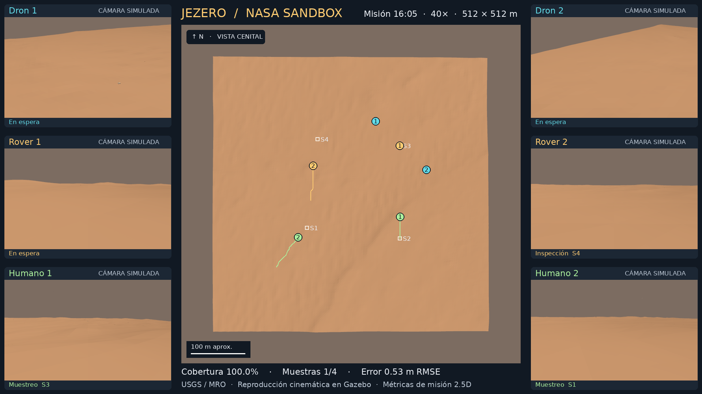

# NASA-Sandbox — exploración marciana heterogénea

Laboratorio con **2 humanos, 2 drones y 2 rovers**. Hay dos pilotos independientes; no confundir la fidelidad ni el estado de ejecución de cada uno.

| Piloto | Terreno | Ejecución comprobada | Límites principales |
|---|---|---|---|
| Base / piloto 0 | Sintético, 90 × 90 m | Gazebo Harmonic: carga, sensores, movimientos y parada; video y logs | Humanos y drones cinemáticos; sin biomecánica ni aerodinámica |
| **Jezero / misión** | **USGS/MRO real, 512 × 512 m, CTX + HiRISE** | **Misión 2.5D, 16 pruebas, seis ejecuciones comparativas, visor y reproducción en Gazebo Harmonic** | Sensores ideales simulados y reproducción cinemática por poses |

## Empezar por el piloto Jezero

[Guía técnica](pilots/jezero/README.md) · [Reporte de resultados](evidence/jezero/report.md) · [Instrucciones para Codex](docs/jezero_pilot_codex.md).

```bash
python3 -m venv .venv-jezero
source .venv-jezero/bin/activate
python -m pip install -r pilots/jezero/requirements.txt
python pilots/jezero/run_all.py
```

Abrir `evidence/jezero/viewer.html` en un navegador. El visor es autónomo: no necesita servidor ni conexión. Desde GitHub se debe descargar el archivo HTML para abrirlo localmente.

El recorte real y sus metadatos se conservan en `data/jezero/`. Si faltan, el importador solicita ventanas de los mosaicos originales; **no los reemplaza por terreno sintético**. Para repetir la importación: `python pilots/jezero/run_all.py --refresh-data`.

La misión comienza con el mapa CTX aproximado. Los drones revelan progresivamente información del DEM de referencia HiRISE y descubren objetivos **ficticios** del escenario. Eso genera inspecciones de rovers y después muestreos humanos. El asignador húngaro y A* usan únicamente el mapa estimado y las tareas descubiertas. La comunicación es global, instantánea y sin pérdidas.

La política informativa se compara con una estrategia de proximidad. En este escenario logra cobertura temprana más rápida, pero tarda más en completar la misión. No se afirma optimalidad global ni reproducción completa de Heterogeneous DisCoverage.

**Datos reales no significa sensores reales:** las observaciones son alturas simuladas bajo una huella ideal, no reconstrucción fotogramétrica. CTX y HiRISE pertenecen ambos a MRO; todavía no se incorporan varias misiones. Los detalles, licencias/fuentes y límites están documentados en la guía y los metadatos.

### Exportación Gazebo del piloto Jezero

`run_all.py` genera `generated/jezero/jezero_mission.sdf`, su malla de terreno y seis agentes. La variante usa agentes estáticos desplazados por poses; es una **reproducción visual de la misión**, no control cerrado ni validación dinámica.

Terminal 1:

```bash
export GZ_PARTITION=jezero_mission
export GZ_SIM_RESOURCE_PATH="$PWD/generated/jezero/models:${GZ_SIM_RESOURCE_PATH:-}"
gz sim -r generated/jezero/jezero_mission.sdf
```

Terminal 2:

```bash
export GZ_PARTITION=jezero_mission
/usr/bin/python3 pilots/jezero/replay_gazebo.py --speed 40
```

Requiere Gazebo Harmonic y bindings `python3-gz-transport13`, `python3-gz-msgs10`.
La ejecución local y la grabación se documentan en el [diagnóstico de Jezero](docs/jezero_diagnostico.md).

[Ver o descargar el montaje con siete cámaras](evidence/jezero_replay/jezero_multivista.mp4).

[](evidence/jezero_replay/jezero_multivista.mp4)

## Conservar el piloto 0 como regresión

El mundo canónico `worlds/mars_sandbox.sdf`, sus modelos y datos sintéticos permanecen separados del nuevo piloto.

```bash
python3 scripts/generate_terrain.py --check
python3 scripts/validate_scene.py
bash scripts/run_gazebo.sh
# En otra terminal:
bash scripts/smoke_commands.sh
```

Para captura reproducible, detener otros servidores del piloto y ejecutar:

```bash
python3 scripts/record_pilot.py
python3 scripts/edit_pilot_video.py
```

[Resultado de la ejecución real](docs/pilot_results.md) · [Video del piloto 0](evidence/piloto_marciano.mp4).

Con ROS 2 Jazzy disponible, `bash scripts/run_ros_bridge.sh` carga el puente de `/clock`, seis `cmd_vel` y seis `odom`. Los tópicos de cámaras deben verificarse antes de incorporarlos al puente. Los comandos de velocidad pueden mantenerse hasta recibir una orden de cero.

## Evidencia y desarrollo

GitHub Actions ejecuta la validación del escenario original y el flujo completo del piloto Jezero. Los resultados principales están en Git y los artefactos de cada ejecución conservan mapas, trayectorias, estados del estimador y exportación 3D durante 30 días. Leer `AGENTS.md` antes de modificar el proyecto.

Este es un laboratorio de preparación independiente del entregable competitivo. Revisar las reglas del evento sobre trabajo previo, reutilización y atribución antes de incorporar material a la competencia.
