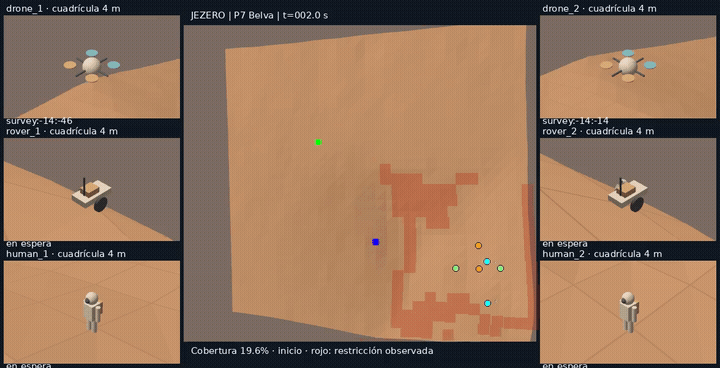

<div align="center">

# NASA-Sandbox · Exploración heterogénea en Marte
### Del conocimiento orbital parcial a las tareas emergentes de un equipo humano–robótico

**Gazebo Harmonic · ROS 2 · Python · USGS/MRO · Multi-agent planning**

[Ver piloto Belva](evidence/jezero_belva/belva.mp4) · [Reporte Belva](evidence/jezero_belva/report.md) · [Misión Jezero y visor](evidence/jezero/viewer.html) · [Manual de ejecución](pilots/jezero/README.md) · [Referencia técnica](README_TECHNICAL.md)

</div>

[](evidence/jezero_belva/belva.mp4)

## La pregunta

¿Cómo coordinar **dos astronautas, dos drones y dos rovers** cuando el mapa inicial es aproximado y nuevas observaciones revelan tareas? El sistema ensaya reconocimiento aéreo, actualización progresiva del mapa, inspección robótica, muestreo humano y retorno.

## Rutas de demostración

| Escenario | Qué muestra | Nivel de fidelidad |
| --- | --- | --- |
| [Piloto base](docs/pilot_results.md) | Seis entidades, sensores y movimientos | Terreno sintético, proxies cinemáticos |
| [Jezero 2.5D](evidence/jezero/report.md) | Datos CTX + HiRISE y asignación húngara con valor informativo | Simulación de misión, observaciones ideales |
| [Jezero en Gazebo](evidence/jezero_live/report.md) | Percepción/cinemática cerradas en simulador | Sensores Gazebo y control simulado |
| [Belva](evidence/jezero_belva/report.md) | Rutas no convexas, tarea inaccesible y seis regresos | Gazebo Harmonic en entorno hipotético con relieve orbital |

### Resultado reproducible del caso Belva

En la serie documentada de **cinco semillas**, los seis agentes regresaron en las **5/5 misiones**. El escenario distingue una tarea de inspección/muestreo factible de otra declarada inaccesible por tierra. Las estadísticas describen exclusivamente esos ruidos simulados, ese terreno y esa configuración. [Métricas por semilla y detalle de los fallos de desarrollo](evidence/jezero_belva/report.md).

## Arquitectura conceptual

```text
Mapa inicial orbital (CTX) ──────────┐
                                    ▼
Percepción local (simulada) ──► Mapa compartido
                                    │
                          descubrimientos / tareas
                                    ▼
                          Asignación y planificación
                                    ▼
                Humanos · Drones · Rovers / retorno
```

Las capas orbitales CTX y HiRISE **pertenecen ambas a MRO**; no satisfacen por sí solas una posible exigencia de combinar varias misiones. Los objetivos del escenario son ficticios. No se afirma reconstrucción fotogramétrica real, vuelo aerodinámico validado ni seguridad de una EVA.

## Reproducir

```bash
python3 -m venv .venv-jezero
source .venv-jezero/bin/activate
python -m pip install -r pilots/jezero/requirements.txt
python pilots/jezero/run_all.py
```

[Comandos Gazebo y configuración](pilots/jezero/LIVE.md) · [Fuente y limitaciones](docs/data_provenance.md) · [Instrucciones Codex](docs/jezero_pilot_codex.md) · [README técnico anterior preservado](README_TECHNICAL.md).

> **Importante para hackatones:** este es un laboratorio de preparación ya existente, no un entregable cuya reutilización en una competencia haya sido autorizada. Verificar reglas de trabajo previo y atribución antes de presentar código o assets.
