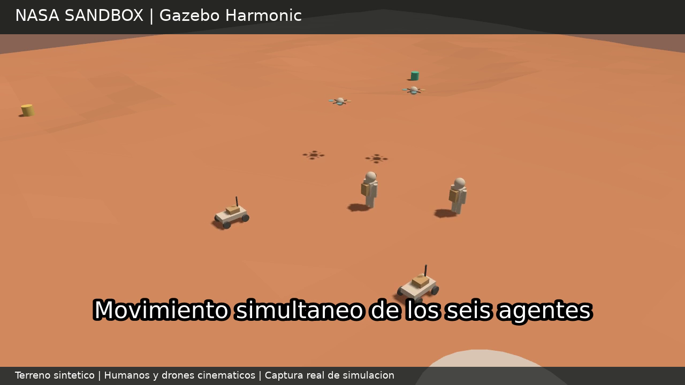

# NASA-Sandbox — laboratorio marciano multiagente

Base experimental en **Gazebo Harmonic + ROS 2 Jazzy** para los pilotos de
NASA Space Apps: **2 astronautas, 2 rovers y 2 drones** en un mundo compartido.

**Importante:** el terreno es sintético, NO es un DEM de NASA. Los astronautas
y drones son *proxies* con control de velocidad, sin biomecánica ni
aerodinámica marciana; los rovers son modelos genéricos de cuatro ruedas con
tracción diferencial. La estructura se entrega para pruebas posteriores
y **no afirma que Gazebo haya sido ejecutado ni que la dinámica esté validada**.

## Contenido

| Tipo | Entidades | Control |
| --- | --- | --- |
| Humanos | `human_1`, `human_2` | `VelocityControl`, movimiento abstracto |
| Rovers | `rover_1`, `rover_2` | `DiffDrive`, cámara RGB |
| Drones | `drone_1`, `drone_2` | `VelocityControl` 3D, cámara RGB |
| Escenario | `mars_terrain`, `habitat`, `science_a/b` | Terreno y marcadores |

El mundo usa gravedad de Marte (`0 0 -3.71` m/s²), retícula de
**31 × 31 alturas a cada 3 m**, cráteres y crestas ficticias, coordenadas
locales `[-45,45]` m. Los datos y posiciones están en
[`data/scenario.json`](data/scenario.json).

## Dependencias

Ubuntu 24.04, **Gazebo Harmonic** (`gz sim`). Opcional:
**ROS 2 Jazzy** y `ros_gz_bridge`. Python 3.11+ para pruebas offline.
[Guía oficial de Gazebo Harmonic](https://gazebosim.org/docs/harmonic/).

## Validaciones estáticas

```bash
python3 scripts/generate_terrain.py --check
python3 scripts/validate_scene.py
```

Los dos recursos de terreno generados, `terrain.obj` y
`terrain_grid.csv`, se incluyen en el repositorio. Para regenerarlos tras
cambiar el algoritmo:

```bash
python3 scripts/generate_terrain.py
```

## Arrancar Gazebo

En la raíz del repositorio:

```bash
bash scripts/run_gazebo.sh
```

El lanzador configura `GZ_SIM_RESOURCE_PATH` y abre
[`worlds/mars_sandbox.sdf`](worlds/mars_sandbox.sdf) sin descargar
modelos externos. Para correr el servidor sin GUI:

```bash
bash scripts/run_gazebo.sh -s
```

Después del arranque, en otra terminal:

```bash
bash scripts/smoke_commands.sh
```

Este script envía órdenes breves a las seis entidades y comandos de parada.
La demo aún requiere ejecución y auditoría; las velocidades cinemáticas
no constituyen un controlador de vuelo.

Comandos manuales:

```bash
gz topic -t /model/rover_1/cmd_vel -m gz.msgs.Twist -p 'linear: {x: 0.2}, angular: {z: 0.1}'
gz topic -t /model/drone_1/cmd_vel -m gz.msgs.Twist -p 'linear: {z: 0.15}'
```

**Detén cada robot** con `linear: {x: 0, y: 0, z: 0}, angular: {z: 0}`:
los controladores pueden mantener la última orden recibida.

## Piloto reproducible con video (P0–P2)

En Ubuntu 24.04 con Harmonic, `python3-gz-transport13`,
`python3-gz-msgs10` y `ffmpeg` instalados:

```bash
python3 scripts/record_pilot.py
```

El script verifica el terreno, genera `worlds/mars_pilot_observation.sdf`
con dos cámaras externas, arranca Gazebo sin GUI y graba imágenes reales
en `evidence/overview.mp4` y `evidence/agents.mp4`. Comprueba desplazamiento
individual usando poses del mundo, recibe las seis odometrías, ejecuta
movimiento simultáneo y comprueba la parada. Los comandos, trayectorias,
resultados y logs quedan en `evidence/`. Usa renderizado software para WSL;
el video tiene 10 fotogramas por segundo de simulación y no mide rendimiento
en tiempo real. El mundo canónico permanece separado del mundo de grabación.
Para ensamblar el video con etiquetas: `python3 scripts/edit_pilot_video.py`.
El resultado de la ejecución está en [docs/pilot_results.md](docs/pilot_results.md).

[Ver o descargar el video del piloto (40 s, 720p)](evidence/piloto_marciano.mp4).

[](evidence/piloto_marciano.mp4)

## ROS 2 opcional

Con Jazzy cargado y Gazebo activo:

```bash
bash scripts/run_ros_bridge.sh
```

[`config/ros_gz_bridge.yaml`](config/ros_gz_bridge.yaml) proporciona
`/clock`, seis `cmd_vel` y seis `odom`. Los tópicos de cámaras deben
inspeccionarse con `gz topic -l` antes de incorporarlos al puente.

## Para Codex

Leer [`AGENTS.md`](AGENTS.md), el
[plan de pilotos](docs/next_pilots.md) y
[procedencia de los datos](docs/data_provenance.md).
Este repositorio es un laboratorio de preparación técnica, independiente de
la entrega competitiva. Verificar reglas de reutilización/atribución del
evento antes de copiar material al proyecto oficial.

## Nuevo piloto: Jezero con datos orbitales reales

[Guía del piloto](pilots/jezero/README.md) · [Resultados ejecutados](evidence/jezero/report.md) · [Continuación con Codex](docs/jezero_pilot_codex.md).

Incluye importación reproducible CTX/HiRISE, mapa inicialmente parcial, mapeo simulado, tareas emergentes y asignación automática entre los seis agentes, sin restricciones de comunicación. Ejecutar `python pilots/jezero/run_all.py` después de instalar sus requisitos. El mundo original sigue siendo sintético; el nuevo escenario es independiente. La misión se evalúa en 2.5D; la exportación Gazebo es una reproducción cinemática, no una ejecución física de control cerrado.
